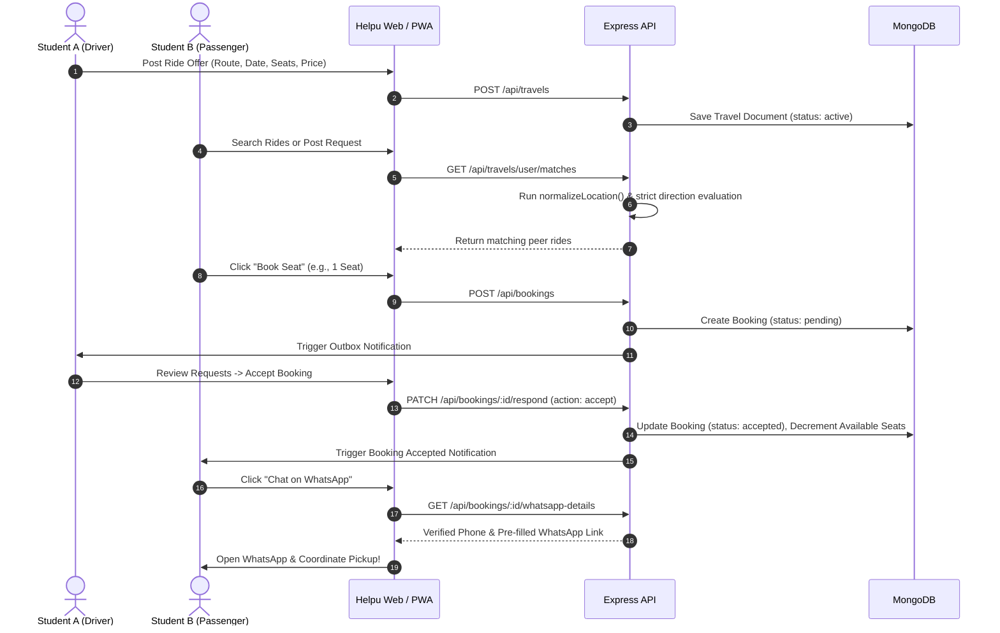
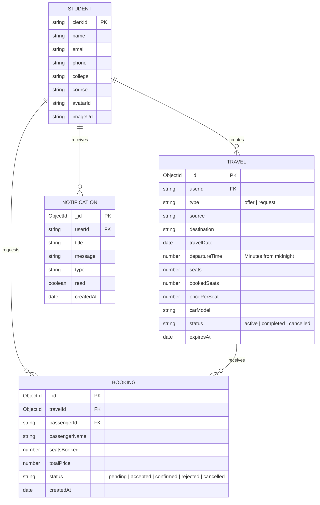

# Helpu — Campus Rides & Peer Travel Network 🚗🎓

[](https://react.dev/)
[](https://vitejs.dev/)
[](https://nodejs.org/)
[](https://www.mongodb.com/)
[](https://tailwindcss.com/)
[](https://web.dev/progressive-web-apps/)
[](https://clerk.com/)

> **Helpu** is a dedicated campus ride-sharing and peer travel network built specifically for university students. It empowers students to offer rides, request seats, discover compatible co-travellers on identical routes, coordinate pickups via WhatsApp, and split fuel costs transparently with zero commission fees.

---

## 📑 Table of Contents

- [1. Project Overview](#1-project-overview)
- [2. Problem Statement](#2-problem-statement)
- [3. Key Features](#3-key-features)
- [4. How Helpu Works](#4-how-helpu-works)
- [5. Tech Stack](#5-tech-stack)
- [6. Project Architecture](#6-project-architecture)
- [7. Folder Structure](#7-folder-structure)
- [8. Installation and Setup](#8-installation-and-setup)
- [9. Environment Variables](#9-environment-variables)
- [10. API Overview](#10-api-overview)
- [11. Database Models Overview](#11-database-models-overview)
- [12. Authentication and Authorization](#12-authentication-and-authorization)
- [13. Ride Matching Logic](#13-ride-matching-logic)
- [14. Booking and Cancellation Flow](#14-booking-and-cancellation-flow)
- [15. Progressive Web App (PWA)](#15-progressive-web-app-pwa)
- [16. Screenshots](#16-screenshots)
- [17. Deployment Instructions](#17-deployment-instructions)
- [18. Future Improvements](#18-future-improvements)
- [19. Contributing Guidelines](#19-contributing-guidelines)
- [20. License](#20-license)

---

## 1. Project Overview

University campuses often suffer from limited public transit connectivity to central hubs such as railway stations, airports, shopping centers, and bus terminals. **Helpu** bridges this gap by creating an exclusive student-to-student mobility network.

Whether you are driving your car or scooter to the city and have empty seats, or you are looking to share a cab with peers heading home for the weekend, Helpu intelligently evaluates your travel date, route, and departure window to connect you with verified peers.

---

## 2. Problem Statement

1. **Exorbitant Travel Expenses:** Cabs to transit hubs (e.g., Bhopal Junction, Rani Kamlapati, Raja Bhoj Airport) are expensive for solo students.
2. **Chaotic WhatsApp Groups:** Students flood informal chat groups with ad-hoc messages that are quickly buried and lack structured search, filters, or tracking.
3. **Safety & Identity Risks:** Travelling with strangers off public platforms poses safety concerns without verified university identity.
4. **Asymmetric Travel Direction:** Traditional chat groups result in accidental pairing of students traveling in opposite directions (e.g., Campus ➔ Station vs. Station ➔ Campus).

---

## 3. Key Features

- 🚘 **Offer Rides:** Post journey details, vehicle model, departure time, seat count, and seat price.
- 📍 **Passenger Requests:** Post a request when you need a ride to a specific campus or city destination.
- 🎯 **Rule-Based Smart Matching:** Automatically pair compatible offers and requests on identical routes, dates, and departure windows.
- 🛡️ **Verified Student Profiles:** Campus identity authentication through Clerk, university domain validation, and custom student avatars.
- 💬 **Direct WhatsApp Coordination:** Once a seat request is confirmed, riders can connect instantly on WhatsApp with one click.
- 🔔 **Real-Time Notification Pipeline:** Outbox event processor with in-app notifications and scheduled ride reminders.
- 📱 **Progressive Web App (PWA):** Installable on Android, iOS, and desktop with standalone display, custom splash loader, and offline fallbacks.
- 🤝 **Peer Community & Help Board:** Dedicated campus feed for sharing quick updates and asking for assistance.

---

## 4. How Helpu Works



---

## 5. Tech Stack

### Frontend
- **Framework:** React 19 (`react`, `react-dom`)
- **Build Tool:** Vite 8
- **Routing:** React Router DOM v7
- **Styling:** Tailwind CSS v4 (`@tailwindcss/vite`)
- **Animations:** Framer Motion v14
- **Icons:** Lucide React
- **Authentication:** `@clerk/clerk-react`
- **HTTP Client:** Axios (with request/response interceptors)
- **PWA Capabilities:** Web App Manifest, Service Worker Cache API

### Backend
- **Runtime:** Node.js (v18+)
- **Framework:** Express.js
- **Database ODM:** Mongoose (MongoDB)
- **Authentication:** `@clerk/express` SDK
- **Background Jobs:** Outbox Event Architecture & BullMQ / Redis reminder integration
- **CORS:** Cross-Origin Resource Sharing middleware

### Database & Cloud
- **Database:** MongoDB Atlas
- **Auth Provider:** Clerk Dev / Production Instance
- **PWA Hosting:** Vercel / Netlify / Self-hosted static server

---

## 6. Project Architecture

```
                    +------------------------------------------+
                    |           Helpu Client / PWA             |
                    | (React 19, Tailwind CSS v4, Service Wkr) |
                    +--------------------+---------------------+
                                         |
                       HTTPS + Bearer JWT Token (Clerk)
                                         |
                                         v
                    +--------------------+---------------------+
                    |          Express REST API                |
                    |  (Routes, Controllers, Clerk Middleware) |
                    +----+---------------+---------------+-----+
                         |               |               |
                         v               v               v
                +--------+---+   +-------+-------+   +---+--------+
                | Matching   |   | Outbox Event  |   | Reminder   |
                | Service    |   | Processor     |   | Service    |
                +--------+---+   +-------+-------+   +---+--------+
                         |               |               |
                         +---------------+---------------+
                                         |
                                         v
                         +---------------+---------------+
                         |        MongoDB Atlas          |
                         | (Students, Travels, Bookings) |
                         +-------------------------------+
```

---

## 7. Folder Structure

```
Idea/
├── backend/
│   ├── src/
│   │   ├── config/             # Database connection & configurations
│   │   ├── controllers/        # Booking, travel, student, and help controllers
│   │   ├── jobs/               # Background notification jobs
│   │   ├── middleware/         # Auth verification and input validation
│   │   ├── models/             # Mongoose schemas (Student, Travel, Booking, etc.)
│   │   ├── queues/             # BullMQ notification queue handlers
│   │   ├── routes/             # REST API endpoint definitions
│   │   ├── services/           # Matching engine, Outbox, and Reminders
│   │   └── app.js              # Express app setup and middleware registration
│   ├── server.js               # Server entry point & graceful shutdown hooks
│   ├── package.json
│   └── .env                    # Backend environment config (ignored)
│
├── frontend/
│   ├── public/
│   │   ├── manifest.webmanifest# PWA Web App Manifest
│   │   ├── sw.js               # Service Worker implementation
│   │   ├── offline.html        # Branded offline fallback page
│   │   ├── pwa-192x192.png     # PWA standard app icon
│   │   ├── pwa-512x512.png     # PWA splash icon
│   │   ├── pwa-maskable-512x512.png # Adaptive maskable icon
│   │   └── car.png, match.png  # Illustrations and brand assets
│   ├── src/
│   │   ├── components/
│   │   │   ├── layout/         # Shell, DesktopNavbar, DesktopSidebar, BottomNav
│   │   │   └── ui/             # Avatar, Modal, OfflineBanner, InstallPwaPrompt
│   │   ├── lib/
│   │   │   └── api.js          # Centralized Axios client & API methods
│   │   ├── pages/              # Views (Home, OfferRide, MyMatches, MyPosts, etc.)
│   │   ├── pwa/                # Service worker registrar and usePwaInstall hook
│   │   ├── App.jsx             # Route definitions, guards, and PWA wrappers
│   │   ├── index.css           # Tailwind v4 theme directives & safe area styles
│   │   └── main.jsx            # React root & ClerkProvider initialization
│   ├── index.html              # HTML shell with meta tags & splash loader
│   ├── vite.config.js          # Vite configuration with Tailwind CSS v4
│   └── package.json
└── README.md
```

---

## 8. Installation and Setup

### Prerequisites
- **Node.js:** v18.0.0 or higher
- **npm** or **pnpm**
- **MongoDB:** Local MongoDB instance or free MongoDB Atlas URI
- **Clerk Account:** Free account at [clerk.com](https://clerk.com) for authentication credentials

### Step 1: Clone the Repository
```bash
git clone https://github.com/Shubhaam-code/HelpU.git
cd HelpU
```

### Step 2: Configure Backend
```bash
cd backend
npm install
```
Create a `.env` file in the `backend/` directory (see [Environment Variables](#9-environment-variables)).

Start the backend development server:
```bash
npm run dev
# Server will start on http://localhost:5000
```

### Step 3: Configure Frontend
In a new terminal window:
```bash
cd ../frontend
npm install
```
Create a `.env` file in the `frontend/` directory:
```env
VITE_CLERK_PUBLISHABLE_KEY=pk_test_your_clerk_key
VITE_API_URL=http://localhost:5000
```

Start the frontend development server:
```bash
npm run dev
# Frontend will run on http://localhost:5173
```

---

## 9. Environment Variables

### Backend (`backend/.env.example`)
```env
# Server Port
PORT=5000

# Database
MONGO_URI=mongodb+srv://<username>:<password>@cluster.mongodb.net/helpu?retryWrites=true&w=majority

# Clerk Authentication
CLERK_PUBLISHABLE_KEY=pk_test_...
CLERK_SECRET_KEY=sk_test_...

# Optional Redis / BullMQ Settings (if using persistent queue)
REDIS_HOST=127.0.0.1
REDIS_PORT=6379
REDIS_USERNAME=
REDIS_PASSWORD=
REDIS_TLS=false
```

### Frontend (`frontend/.env.example`)
```env
# Clerk Authentication
VITE_CLERK_PUBLISHABLE_KEY=pk_test_...

# Backend API Base URL
VITE_API_URL=http://localhost:5000
```

> ⚠️ **Important:** Never commit `.env` files containing real production secrets, passwords, or private keys to source control.

---

## 10. API Overview

All protected endpoints require an `Authorization: Bearer <JWT>` header obtained automatically via Clerk session tokens.

### 🚗 Travels (`/api/travels`)
| Method | Endpoint | Access | Description |
| :--- | :--- | :--- | :--- |
| `GET` | `/api/travels` | Protected | List active, non-expired travel offers and requests |
| `POST` | `/api/travels` | Protected | Create a new ride offer or travel request |
| `GET` | `/api/travels/my` | Protected | Get all active posts created by the current user |
| `GET` | `/api/travels/user/matches` | Protected | Retrieve all matching rides across user's active posts |
| `GET` | `/api/travels/:id` | Protected | Get single travel post details |
| `GET` | `/api/travels/:id/matches` | Protected | Get compatible matching rides for a specific post |
| `PATCH` | `/api/travels/:id/status` | Protected | Update post status (`active`, `completed`, `cancelled`) |

### 🎟️ Bookings (`/api/bookings`)
| Method | Endpoint | Access | Description |
| :--- | :--- | :--- | :--- |
| `POST` | `/api/bookings` | Protected | Request seats on an active ride offer post |
| `GET` | `/api/bookings/my` | Protected | Get bookings initiated by the logged-in passenger |
| `GET` | `/api/bookings/received` | Protected | Get seat requests received by the ride creator |
| `GET` | `/api/bookings/:id` | Protected | Get single booking reservation details |
| `PATCH` | `/api/bookings/:id/respond` | Protected | Accept or reject a pending seat request |
| `PATCH` | `/api/bookings/:id/cancel` | Protected | Cancel a reservation and restore available seats |
| `GET` | `/api/bookings/:id/whatsapp-details` | Protected | Retrieve driver/passenger phone for confirmed rides |

### 👤 Student Profiles (`/api/students`)
| Method | Endpoint | Access | Description |
| :--- | :--- | :--- | :--- |
| `GET` | `/api/students/profile` | Protected | Fetch current student profile from MongoDB |
| `POST` | `/api/students/profile` | Protected | Create or synchronize student profile with Clerk |
| `PUT` | `/api/students/profile` | Protected | Update phone, college, course, and avatar selection |

### 🔔 Notifications (`/api/notifications`)
| Method | Endpoint | Access | Description |
| :--- | :--- | :--- | :--- |
| `GET` | `/api/notifications` | Protected | Fetch user notifications with read status |
| `GET` | `/api/notifications/unread-count` | Protected | Get live unread notification counter |
| `PATCH` | `/api/notifications/:id/read` | Protected | Mark a single notification as read |
| `PATCH` | `/api/notifications/read-all` | Protected | Mark all user notifications as read |

---

## 11. Database Models Overview



---

## 12. Authentication and Authorization

Helpu leverages **Clerk** for zero-trust campus identity management:

1. **Client-Side Auth:** Users sign in using institutional emails or OAuth on `AuthPage.jsx`.
2. **Token Injection:** Axios request interceptor attaches the fresh session JWT:
   ```javascript
   config.headers.Authorization = `Bearer ${await getToken()}`;
   ```
3. **Server-Side Verification:** Express routes pass through `clerkMiddleware()` and `requireAuth` to validate the cryptographic token signature and extract `req.userId`.
4. **Auto-Synchronization:** When a student logs in, `TokenInjector` automatically synchronizes their Clerk profile picture, email, and full name with the MongoDB `Student` record.

---

## 13. Ride Matching Logic

The matching service ([`matching.service.js`](file:///c:/Users/Shubham%20Narayan/Desktop/Idea/backend/src/services/matching.service.js)) implements strict heuristic rules:

1. **Directional Equivalence:**
   - Both locations are normalized using regex alias tables:
     - `vit bhopal` ➔ Campus aliases (`vit`, `vitb`, `kothri`, `campus`)
     - `bhopal junction` ➔ Main railway station
     - `rani kamlapati` ➔ RKMP / Habibganj
     - `bhopal airport` ➔ Raja Bhoj / Airport
   - **Guard against opposite trips:** Campus ➔ Station will **never** match Station ➔ Campus.
2. **Calendar Day Matching:** Both trips must fall on the exact same date in the `Asia/Kolkata` timezone.
3. **Departure Window Flexibility:** Matches are evaluated against departure times within a flexible window of ±60 to 120 minutes.
4. **Capacity Validation:** Candidate passenger request seats must not exceed the driver's available seats.
5. **Self-Exclusion:** A student's post is never matched against their own travel posts.

---

## 14. Booking and Cancellation Flow

```
[Passenger sends Booking Request]
              │
              ▼
       (status: pending)
              │
       ┌──────┴──────┐
       │             │ Driver Rejects
Driver │             └───────────────► (status: rejected)
Accepts│
       ▼
(status: accepted / confirmed)
   • bookedSeats incremented atomically
   • Driver & passenger receive confirmation
   • Outbox triggers scheduled reminders
              │
       ┌──────┴──────┐
       │             │ Driver or Passenger Cancels
       ▼             └───────────────► (status: cancelled)
Trip Completed                           • bookedSeats refunded atomically
(status: completed)                      • Reminder jobs cleaned up
```

---

## 15. Progressive Web App (PWA)

Helpu is a modern, installable PWA that works seamlessly across mobile and desktop browsers:

- **Installable Experience:** Supported on Google Chrome, Microsoft Edge, Android, and iOS Safari.
- **Service Worker (`sw.js`):**
  - Caches app shell, fonts, styles, and static illustrations.
  - Implements a strict **network-only** bypass for all sensitive API endpoints, Clerk authentication, and mutation requests.
- **Offline Fallback Page (`offline.html`):** When internet connectivity drops, users are presented with a clean retry UI.
- **Native Loading Experience:** Inline HTML splash screen inside `index.html` renders instantly with pulsing brand logo while the React bundle hydrates.
- **Edge-to-Edge Displays:** Safe area inset support (`safe-area-pb`, `safe-area-pt`) for modern mobile notches and gesture bars.

---

## 16. Screenshots

| Home & Campus Discover | Offer a Ride Layout |


| My Travel Matches | Student Profile & PWA Install |


---

## 17. Deployment Instructions

### Frontend (e.g., Vercel / Netlify)
1. Push your repository to GitHub.
2. Connect your repo to **Vercel** or **Netlify**.
3. Set the Root Directory to `frontend`.
4. Configure Build Command: `npm run build` and Output Directory: `dist`.
5. Add Environment Variables:
   - `VITE_CLERK_PUBLISHABLE_KEY`
   - `VITE_API_URL` (points to your deployed backend domain)

### Backend (e.g., Render / Railway / Fly.io)
1. Deploy as a Web Service with Root Directory set to `backend`.
2. Build Command: `npm install`
3. Start Command: `npm start`
4. Add Environment Variables (`PORT`, `MONGO_URI`, `CLERK_PUBLISHABLE_KEY`, `CLERK_SECRET_KEY`).
5. Ensure your MongoDB Atlas Network Access whitelist permits connections from your hosting IP (or `0.0.0.0/0`).

---

## 18. Future Improvements

- [ ] **Live Route Tracking:** Real-time geofenced pickup arrival indicators.
- [ ] **Automated UPI Payment Split:** Direct integration with campus payment QR codes.
- [ ] **Inter-College Expansion:** Multi-campus support with domain-specific verification.
- [ ] **Luggage Compatibility Tag:** Indicate boot space (small backpack vs. large trolley).
- [ ] **Push Notifications:** Web Push protocol for background ride alerts when the browser is closed.

---

## 19. Contributing Guidelines

Contributions make the open-source community an amazing place to learn, inspire, and create. Any contributions you make are **greatly appreciated**.

1. Fork the Project.
2. Create your Feature Branch:
   ```bash
   git checkout -b feature/AmazingFeature
   ```
3. Commit your Changes:
   ```bash
   git commit -m "feat: add AmazingFeature"
   ```
4. Push to the Branch:
   ```bash
   git push origin feature/AmazingFeature
   ```
5. Open a Pull Request.

---

## 20. License

Distributed under the **MIT License**. See `LICENSE` for more information.

---

<div align="center">
  <sub>Built with ❤️ for university campus mobility.</sub>
</div>

